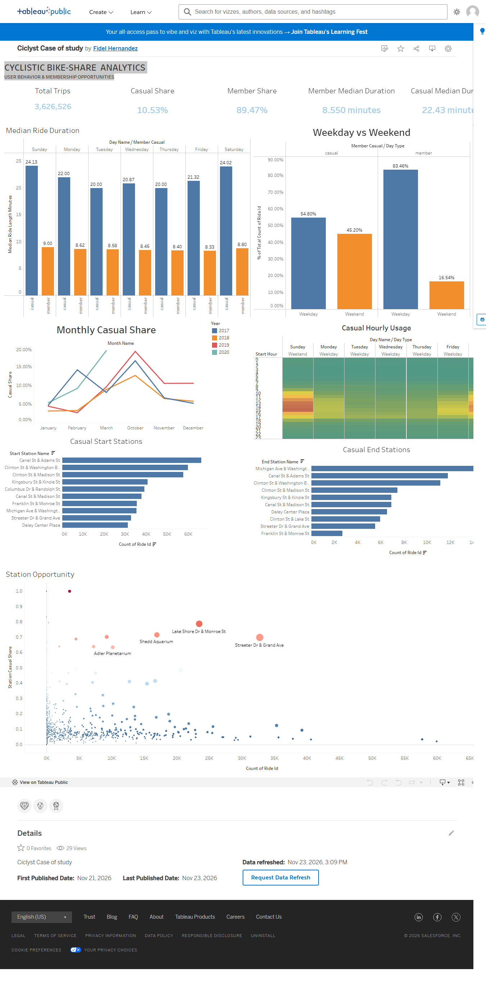

# CYCLISTIC-BIKE-SHARE-ANALYTICS-USER-BEHAVIOR-MEMBERSHIP-OPPORTUNITIES
Google Data Analytics capstone project analyzing Cyclistic bike-share data using SQL, Python, and Tableau. Compares usage patterns between casual riders and annual members to uncover actionable marketing opportunities for converting casual users into annual subscribers.

